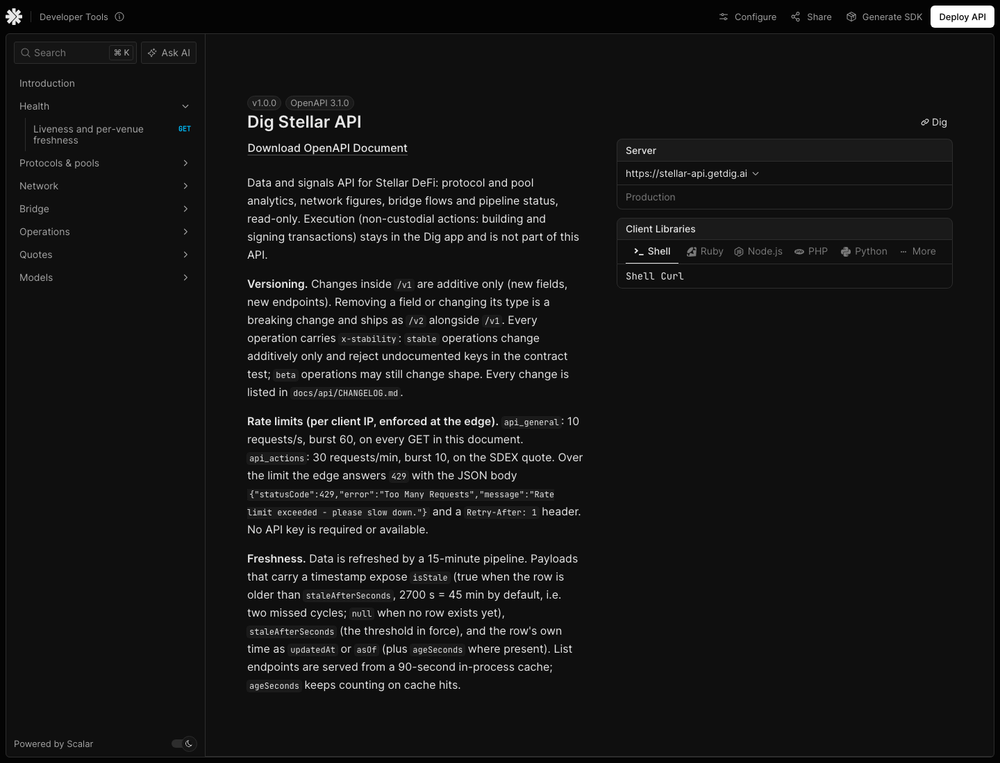

# API3 — docs page capture and route headers (2026-11-03)

`GET /v1/docs` rendered locally from the **built dist** (`pnpm -C apps/api build`, then
`node apps/api/dist/main.js` on `127.0.0.1:3102` against the local compose Postgres), captured
with the local Google Chrome in headless mode (`--headless=new --window-size=1440,1100
--virtual-time-budget=15000 --screenshot`). The repo has no Playwright or Puppeteer tooling; the
screenshot below is the local Chrome capture; the production capture, taken after the
2026-11-03 deploy, is in `api5-prod-verification.md` (`api5-prod-docs-page.png`).



What the capture shows: the Scalar API Reference shell with the "Dig Stellar API v1.0.0"
title, the `info.description` (positioning, versioning, rate limits, freshness), the
production server selector, and the sidebar with the six tags (Health expanded to its
operation; Protocols & pools, Network, Bridge, Operations, Quotes collapsed) plus a Models
section. The "Generate SDK" / "Deploy API" buttons are Scalar's own chrome, not Dig features.

## Scalar pin

The page loads `https://cdn.jsdelivr.net/npm/@scalar/api-reference@1.76.4/dist/browser/standalone.js`
(resolved from the CDN's `latest` tag on 2026-11-03; `curl -sI` on the pinned URL answers
`HTTP/2 200`, `application/javascript`, 4 912 231 bytes). Bump procedure: `docs/api/README.md`.

## Route headers (built dist, local)

`curl -sI http://127.0.0.1:3102/v1/openapi.json`

```text
HTTP/1.1 200 OK
Vary: Origin
Access-Control-Allow-Credentials: true
Access-Control-Allow-Origin: *
Cache-Control: public, max-age=3600
Content-Type: application/json; charset=utf-8
Content-Length: 50655
ETag: W/"c5df-D7B9+aUXrzBgYPgOQ1TKKHvt7SY"
Date: Tue, 03 Nov 2026 18:46:42 GMT
Connection: keep-alive
Keep-Alive: timeout=5

```

`curl -sI http://127.0.0.1:3102/v1/docs`

```text
HTTP/1.1 200 OK
Vary: Origin
Access-Control-Allow-Credentials: true
Access-Control-Allow-Origin: *
Cache-Control: public, max-age=3600
Content-Type: text/html; charset=utf-8
Content-Length: 656
ETag: W/"290-CVYbKDzcMzvsYmJHsggOKidckJ8"
Date: Tue, 03 Nov 2026 18:46:42 GMT
Connection: keep-alive
Keep-Alive: timeout=5

```

Both routes carry `Content-Type` (JSON / `text/html; charset=utf-8` for the nginx `nosniff`
header), `Cache-Control: public, max-age=3600` and a route-local
`Access-Control-Allow-Origin: *`. The `Vary: Origin` and `Access-Control-Allow-Credentials:
true` lines come from the unchanged global CORS middleware in `main.ts` (allow-list +
credentials); on a request from a non-allow-listed origin the middleware sets no origin header
and the route-local `*` applies, so a plain (non-credentialed) cross-origin `fetch` of the
contract works, while a credentialed one is still refused by the browser — the intended
boundary. The data endpoints keep today's CORS policy.

## Checks run on the same build

| Check | Result |
|---|---|
| `pnpm -C apps/api build` | green, `dist/openapi/openapi.v1.yaml` present |
| `pnpm -C apps/api test` | 387 passed, 43 skipped, 430 total (unchanged) |
| `pnpm -C apps/api test:contract` | 40/40 checks passed |
| `curl -s …/v1/openapi.json \| jq .info.version` (built dist) | `"1.0.0"` |
| `curl -sI …/v1/docs` (built dist) | `text/html; charset=utf-8` |
