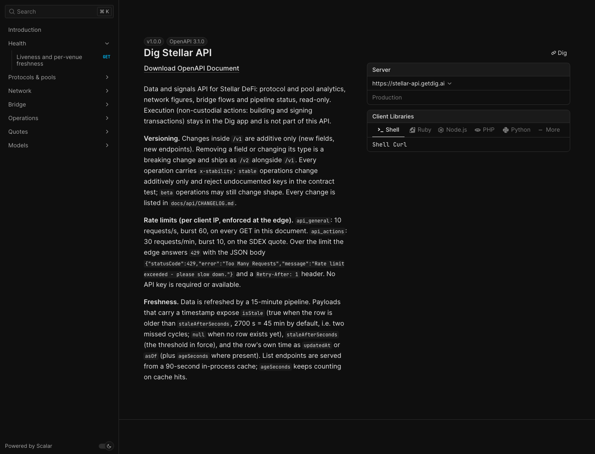
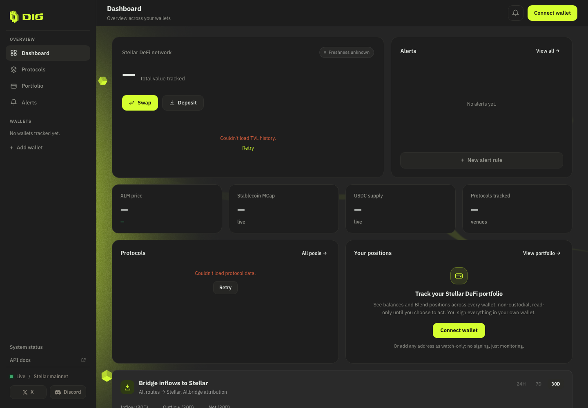
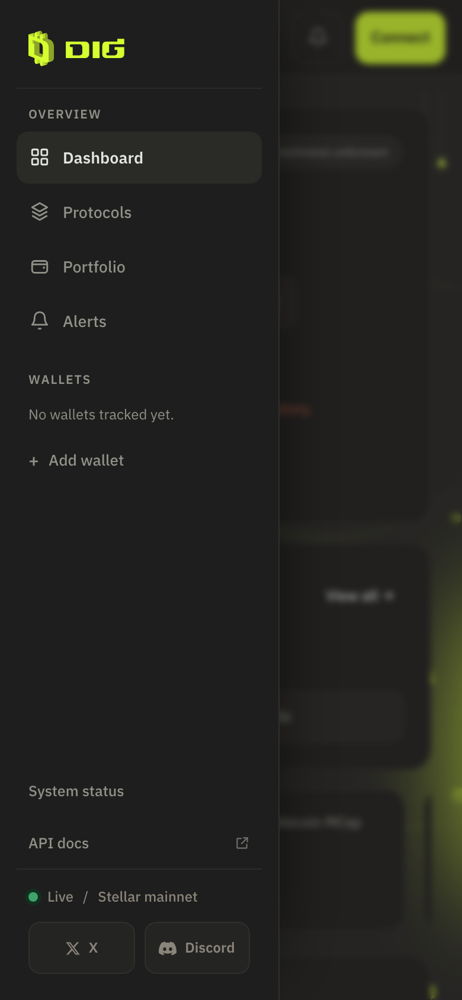

# API5 — production verification and web link (2026-11-03)

Lot API deployed to the VPS at `de1b8bb` (= `origin/main`). Three calls against production, one
each, captured at **2026-11-03T19:45:00Z** (nothing else was sent to prod for this step), plus a headless
Chrome capture of the production docs page and two local captures of the new web link.

## Production

`curl -s https://stellar-api.getdig.ai/v1/openapi.json | jq '.info.version, (.paths|length)'`

```text
"1.0.0"
15
```

`curl -sI https://stellar-api.getdig.ai/v1/docs`

```text
HTTP/1.1 200 OK
Server: nginx
Date: Tue, 03 Nov 2026 19:45:01 GMT
Content-Type: text/html; charset=utf-8
Content-Length: 656
Connection: keep-alive
Vary: Origin
Access-Control-Allow-Credentials: true
Access-Control-Allow-Origin: *
Cache-Control: public, max-age=3600
ETag: W/"290-CVYbKDzcMzvsYmJHsggOKidckJ8"
Strict-Transport-Security: max-age=31536000
X-Content-Type-Options: nosniff
X-Frame-Options: DENY
Referrer-Policy: no-referrer

```

`curl -s https://stellar-api.getdig.ai/health | jq '.status, .version'`

```text
"ok"
"de1b8bb"
```

The page in production, captured with the local Google Chrome in headless mode
(`--headless=new --window-size=1440,1100 --virtual-time-budget=15000 --screenshot`, same method
as `api3-docs-page.md`), 2026-11-03T19:45:00Z:



Both nginx-side headers (`nosniff`, HSTS, `X-Frame-Options`, `Referrer-Policy`) and the
route-local ones (`text/html; charset=utf-8`, `public, max-age=3600`,
`Access-Control-Allow-Origin: *`) are present; no nginx change was made for this lot.

## Web link (`feat/lot-api-web`)

One change in `apps/web/src/components/shell/AppSidebar.vue`: an "API docs" row under
"System status", an `<a>` with `target="_blank"` and `rel="noopener noreferrer"`, external-link
glyph in the nav icon style, URL derived from the one API base the app already uses
(`getApiBaseUrl()` + `/docs`): `https://stellar-api.getdig.ai/v1/docs` in production (the
built bundle contains that host once, as the default base) and `http://localhost:3000/v1/docs`
in dev (`VITE_API_BASE`). No new route, no new view.

Captures from `vite preview` of a build made with `VITE_API_BASE=http://127.0.0.1:3000` so the
preview never calls production (the preview origin is not in the local API's CORS allow-list,
hence the data cards' error states — the captures are about the sidebar):

| Capture | File | Measured |
|---|---|---|
| Desktop sidebar, 1440×1000, headless Chrome | `api5-web-sidebar-desktop.png` | "API docs" row with the external glyph under "System status" |
| 390×844 drawer, DevTools-protocol driven headless Chrome (burger clicked) | `api5-web-sidebar-390-drawer.png` | link rect **44 px** high × 207 px wide; `document.documentElement.scrollWidth` = 390 = `innerWidth` (no horizontal overflow); `href` = `http://127.0.0.1:3000/v1/docs`, `target` = `_blank`, `rel` = `noopener noreferrer` |





Checks: `pnpm -C apps/web build` green (vue-tsc + vite, with and without `VITE_API_BASE`);
`pnpm -C apps/web test` 161 passed in 12 files, unchanged (same count with the sidebar change
stashed).
