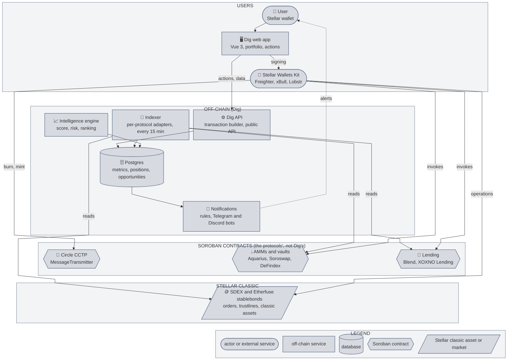
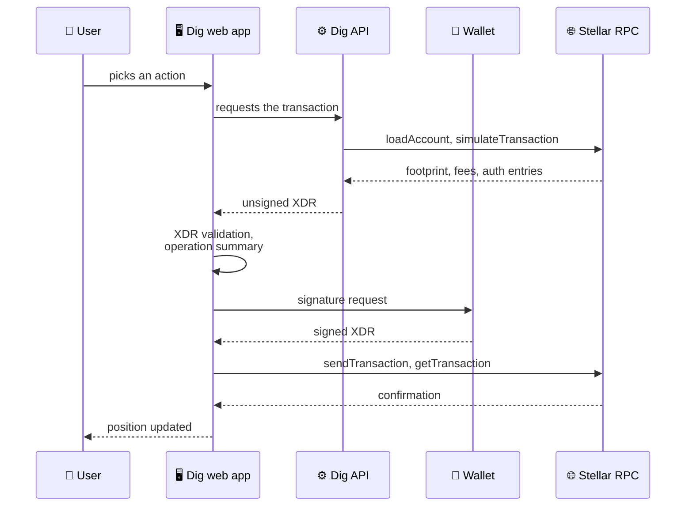
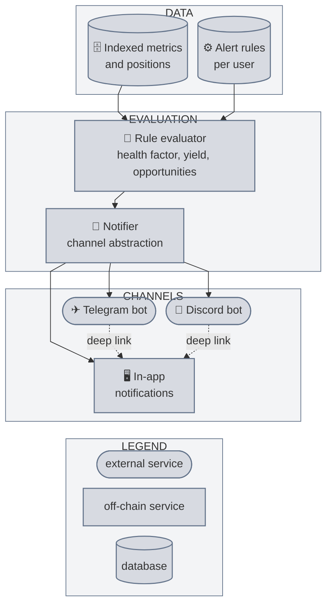

# Dig: Stellar DeFi Intelligence & Position Management Layer (Technical Architecture)

This document is the technical architecture of a DeFi intelligence and position management layer for Stellar. It focuses on the new capabilities built on top of our indexing and analytics infrastructure, already in production.

---

## 1. Objectives

Dig is building the unified management layer for Stellar DeFi. Where existing tools stop at read-only analytics and per-protocol interfaces, this product lets an active DeFi user manage all positions, compare all yield sources, and act on every integrated protocol from a single interface.

- **Rank**: continuously score and compare yield opportunities across lending, AMM liquidity, yield vaults, and tokenized real-world assets, with risk signals and net-of-cost returns.
- **Manage**: provide deep position management on each protocol: lending supply and withdrawal, LP add/remove, reward claims, vault allocation, and health-factor monitoring.
- **Act**: execute protocol actions in one click (or one atomic batch where the protocol supports it), with the transaction built server-side and signed exclusively in the user's wallet.
- **Alert**: notify the user through Telegram and Discord when a position requires attention, with a direct link to the pre-built resolution action on Dig.
- **Bridge**: move native USDC from external chains into Stellar via Circle CCTP.

The product is non-custodial by construction: the backend stores only public addresses and user preferences, never holds private keys, and never signs on a user's behalf. Dig does not deploy its own Soroban contracts. Every on-chain action is a direct invocation of the integrated protocol's existing contracts.

---

## 2. Components

| Component | Status | Role |
|---|---|---|
| Indexing pipeline (Stellar RPC, Horizon as a complement) | existing | Ingests and normalizes data from six protocols into a unified Postgres store, refreshed every 15 minutes |
| Read adapters: Blend, XOXNO Lending, Aquarius, Soroswap, DeFindex, SDEX | existing | Normalized metrics per protocol and per pool, positions of tracked wallets |
| Etherfuse adapter | new | Indexes stablebonds (balances, prices, accrued yield), buy and sell |
| Transaction builder | existing, extended | Multi-operation XDR envelopes, `simulateTransaction`, client-side validation, in-wallet signing |
| Per-protocol execution layer | new | Lending actions on Blend and XOXNO Lending, LP on Aquarius and Soroswap, DeFindex vaults, SDEX orders, Etherfuse stablebonds |
| Intelligence engine | new | Yield estimate, category-specific risk signals, composite score, cross-category ranking served by `/v1/opportunities` |
| Notification layer | existing, extended | Rule evaluator and in-app delivery, extended to Telegram and Discord bots |
| Cross-chain capital import | new | Circle CCTP orchestration (burn, attestation, mint) with no contract of our own |
| Multi-wallet portfolio | existing, enriched | LP, stablebond and multi-protocol lending positions, cross-protocol summary |
| Public API, TypeScript SDK, MCP server | existing | Read-only OpenAPI 3.1 contract, `@getdig/stellar-api` and `@getdig/stellar-mcp` on npm |

Stellar's role: every action Dig builds is a Stellar transaction signed by the user and executed on the protocols' contracts or on the SDEX; every figure that feeds the ranking and the alerts comes from on-chain state (Stellar RPC, Horizon, Reflector prices).

---

## 3. Relationship to the Existing Infrastructure

This scope extends our existing Stellar work, built in the same monorepo. The following layers already exist and are reused as the foundation; they are not rebuilt here:

- **Hybrid indexing pipeline**: Stellar RPC is the primary data plane (contract state, events, simulation); Horizon is used only as a complement, where RPC has no equivalent today (SDEX trades and path quotes, classic liquidity pools) and for history beyond RPC's retention window, a path we will migrate to `getLedgerEntries` and a data lake (Galexie, Hubble) as those reads become available there. Ingestion normalizes protocol data into a unified Postgres store, with a canonical refresh job producing latest per-pool and per-protocol metrics, reserve snapshots, and asset prices, every value carrying its freshness (`asOf`, `isStale`).
- **Protocol read adapters**: Blend (pool reserves, user positions and health factor via the Blend SDK and the pool oracles), XOXNO Lending (three hubs, twenty-five markets, read from the on-chain views of the pool and the controller), Aquarius (pools, reserves, pool events), Soroswap (pairs, reserves, swap events), DeFindex (vaults via the DeFindex SDK), and SDEX (trades, classic liquidity pools). Each produces normalized metrics in the unified schema.
- **Grouped multi-wallet portfolio**: persistent grouping of multiple tracked addresses per user, one designated active signer, watch-only addresses that can never sign, balance snapshots and per-wallet refresh.
- **Non-custodial transaction builder**: server-side construction of multi-operation XDR envelopes, `simulateTransaction` preflight for Soroban actions, client-side XDR validation against the declared intent, and in-wallet signing via Stellar Wallets Kit. In production today for SDEX swaps and Blend supply and withdraw, behind a kill-switch, a per-transaction cap and an issuer-verified asset whitelist.
- **Pool-status protection**: when a pool's governance state forbids an action (pool frozen or paused), simulation fails, the API returns an empty XDR with the raw diagnostic, the wallet is never invoked, and the user is alerted by the status-change alert.
- **In-app alerting**: five rule families (wallet health factor, asset price, pool TVL drop, pool supply and borrow APY, automatic pool-status protection) evaluated on a periodic 15-minute sweep against the indexed snapshots, delivered as in-app notifications.
- **Public read API**: OpenAPI 3.1 contract served at `/v1/openapi.json` and rendered at `/v1/docs`, fifteen operations with an explicit stability tier, a contract test that boots the real application before each deploy; CI regenerates the SDK types from the contract and fails on drift, and checks the documentation links; TypeScript SDK `@getdig/stellar-api`, generated from the same contract, and MCP server `@getdig/stellar-mcp`, built on the SDK, published on npm.

The new layers below (deep protocol execution, intelligence and ranking, Etherfuse integration, cross-chain import, external notification delivery) are built on top of these.

---

## 4. System Architecture



The detailed path of an action, from ranked opportunity to confirmed transaction, is in §7; notifications are in §9.

---

## 5. Core Design Principles

- **Non-custodial by construction.** The backend stores only public addresses and preferences. Every action is a proposal: an XDR built server-side, validated client-side, and signed in the user's wallet. The backend never sees a private key and never submits an unapproved transaction.
- **No custom contracts.** Dig does not deploy Soroban contracts. Every on-chain action is a direct call to an existing protocol contract (Blend, XOXNO Lending, Aquarius, Soroswap, DeFindex, SDEX, Etherfuse issuer, CCTP). This eliminates smart-contract risk attributable to Dig.
- **On-chain as source of truth.** Any metric that drives an opportunity ranking or an alert is derivable from on-chain state (Soroban contract reads through Stellar RPC, Horizon for classic data, Reflector oracle prices). Off-chain SDKs and APIs are used for metadata and convenience, never as the authoritative source.
- **Same contracts, better access.** Using Dig carries the same smart-contract risk as using each protocol's own frontend. The user calls the same contract functions with the same parameters. What Dig adds is aggregation, comparison, and pre-built transactions across protocols.
- **Standards-first execution.** Transaction handoff uses Stellar Wallets Kit: the XDR is built server-side, decoded and validated client-side, and signed in-wallet. No custom signing flows where a Stellar standard exists.
- **Explicit about ledger semantics.** The design accounts for ~5-second ledger close, deterministic finality (no reorgs), Soroban resource fees and storage TTL/archival, and the constraint on mixing classic and Soroban operations in a single envelope (§7.2).

---

## 6. Stellar Building Blocks: Deep Integration Plan

This is the heart of the architecture. For each integrated protocol, the table below shows what the existing foundation already reads and what this scope adds in terms of execution and position management.

### 6.1 Blend: From Analytics to Full Position Management

**Existing (read foundation and first execution):**

- Pool state via the Blend SDK (`PoolV2.load`, reserve ledger entries): supplied, borrowed, rate model state
- User positions via the SDK's `Positions` ledger entries, read in batches: collateral and liability per asset
- Derived: utilization, APY curves, health factor (effective collateral over effective liabilities, from the SDK's positions estimate over the user's positions and the pool's oracle prices, collateral and liability factors applied)
- Execution in production: `submit()` with a single deposit or withdraw Request, on vetted pools

**New in this scope:**

| Capability | Contract surface | Detail |
|---|---|---|
| **Claim BLND emissions** | `pool.claim(from, reserve_token_ids: Vec<u32>, to) → i128` | Claims the BLND emissions accrued on the user's positions in a pool, in one call. Dig shows the claimable amount per pool and builds the transaction. |
| **Health factor actions** | `pool.submit(from, spender, to, requests: Vec<Request>)` with `Request { request_type: 2 (SupplyCollateral), address, amount }` or `Request { request_type: 5 (Repay), address, amount }` | When the notification layer detects a health factor drop, Dig pre-builds the resolution transaction (add collateral or partial repay) and links to it from the alert. |
| **Batch rebalance** | `pool.submit(from, spender, to, requests: Vec<Request>)` with multiple Requests of different types | `submit()` accepts a `Vec<Request>` with mixed types (0=Supply, 1=Withdraw, 2=SupplyCollateral, 3=WithdrawCollateral, 4=Borrow, 5=Repay). All operations execute atomically in one Soroban invocation; the entire call reverts if the resulting position is unhealthy. Dig surfaces rebalance scenarios (e.g., "withdraw collateral A + deposit collateral B") as one-click actions. |

**Blend SDK reference:** `@blend-capital/blend-sdk`, module `pool` (PoolContract, RequestType, Positions).

### 6.2 XOXNO Lending: Second Lending Protocol, Read and Execution

**What it is:** a collateralized lending protocol on Soroban, with a central pool that holds the tokens and keeps each market's accounting, a controller that manages accounts, authorization and risk, and a price aggregator (Reflector, RedStone, XOXNO feeds). A market is a `HubAssetKey { hub_id, asset }`; markets are grouped in hubs (Core, RWA, AMM). An account is represented by a position NFT whose owner controls all of its positions.

**Existing (read foundation):**

- Three hubs, twenty-five markets indexed from the on-chain views: `get_supplied_amount`, `get_borrowed_amount`, `get_utilisation`, `get_deposit_rate`, `get_borrow_rate`, `pool.get_reserves`
- TVL defined as pool cash priced over the markets we have a price for; unpriced markets are listed separately, never priced at 1; a bounded fallback to the protocol's own price aggregator (24-hour maximum age) covers only the markets with no price source of their own
- Static parameters (`get_sync_data`: decimals, interest rate model) read at most once per 24 hours

**New in this scope:**

| Capability | Contract surface | Detail |
|---|---|---|
| **Supply** | `controller.supply(caller, account_id: u64, spoke_id: u32, assets: Vec<(HubAssetKey, i128)>) → u64` | An `account_id` of 0 creates the user's account (position NFT) and returns its id; Dig stores the id per wallet. |
| **Withdraw** | `controller.withdraw(caller, account_id, withdrawals: Vec<(HubAssetKey, i128)>, to) → Vec<(HubAssetKey, i128)>` | A zero amount withdraws everything; the function returns the amounts actually paid. |
| **Repay** | `controller.repay(caller, account_id, payments: Vec<(HubAssetKey, i128)>)` | Open to anyone; excess returns to the caller. This is the resolution action linked from a health-factor alert on XOXNO. |
| **Health factor** | `controller.get_health_factor(account_id) → i128` (WAD) and `controller.get_account_positions(account_id)` | Read by the indexer for the accounts of tracked wallets, at the same cadence as Blend; same alert threshold, same pre-built action. |

XOXNO positions appear in the portfolio next to Blend positions, with the same data model (supplied, borrowed, health factor). The protocol's code is licensed PolyForm Noncommercial: our adapter derives nothing from the code, it reads the on-chain spec (`contractspecv0`) and calls the published functions.

### 6.3 Aquarius: LP Management, Reward Claims, and Analytics

**Existing (read foundation):**

- Pool state via Soroban contract reads over Stellar RPC (`get_info`, `get_reserves`, `get_tokens`)
- Pool events via `getEvents`: `trade`, `deposit_liquidity`, `withdraw_liquidity`, `update_reserves`
- Derived: TVL, 24-hour volume and fees

**New in this scope:**

| Capability | Contract surface | Detail |
|---|---|---|
| **LP deposit** | `liquidity_pool.deposit(env, user, tokens: Vec<Address>, pool_index: BytesN<32>, desired_amounts: Vec<u128>, min_shares: u128) → (Vec<u128>, u128)` | User provides liquidity to an Aquarius pool (volatile, stableswap, or concentrated). Returns actual amounts deposited and shares minted. Aquarius uses `u128` (unsigned), unlike Blend and Soroswap which use `i128`. |
| **LP withdraw** | `liquidity_pool.withdraw(env, user, tokens: Vec<Address>, pool_index: BytesN<32>, share_amount: u128, min_amounts: Vec<u128>) → Vec<u128>` | Burns LP shares and returns underlying tokens. `min_amounts` protects against slippage. |
| **Claim AQUA rewards** | `pool_contract.claim(user_address) → u128` | Claims accumulated AQUA emissions for the user's LP position, called on the pool contract address directly. Rewards accrue per second. Returns amount claimed (divide by 10^7 for AQUA). |
| **Impermanent loss tracking** | Computed by Dig, not a contract call | For each LP position, Dig computes: (a) current position value from pool reserves and Reflector prices, (b) hold-equivalent value from entry amounts at current prices, (c) net P&L = fees earned + AQUA rewards − impermanent loss. Entry data comes from indexed deposit events. |
| **Bribing visibility** | Aquarius Bribes API: `GET bribes-api.aqua.network/api/bribes/` and Market Keys API: `GET marketkeys-tracker.aqua.network/api/market-keys/` | Aquarius exposes a public REST API returning active bribes per market: `market_key`, `total_reward_amount`, `daily_amount`, `start_at/stop_at` (weekly periods), and AQUA equivalent. Cross-referencing with the Market Keys API resolves each `market_key` to its asset pair. Dig reads both APIs to compute bribe APR per pool (daily amount × AQUA price / pool TVL) and integrates it into the opportunity score. |

**Pool types:** Aquarius operates three pool types on Soroban: volatile (xy = k), stableswap (optimized for correlated assets), and concentrated liquidity (tick ranges). The adapter handles all three; the `pool_index: BytesN<32>` parameter identifies each pool uniquely.

### 6.4 Soroswap: LP Management via Router

**Existing (read foundation):**

- Factory enumeration, pair reserves, swap events

**New in this scope:**

| Capability | Contract surface | Detail |
|---|---|---|
| **Add liquidity** | `Router.add_liquidity(env, token_a, token_b, amount_a_desired: i128, amount_b_desired: i128, amount_a_min: i128, amount_b_min: i128, to: Address, deadline: u64) → (i128, i128, i128)` | Adds liquidity to a Soroswap pair via the Router. Returns `(amount_a_actual, amount_b_actual, liquidity_minted)`. The Router calculates the optimal ratio. `deadline` is a Unix timestamp after which the transaction fails. |
| **Remove liquidity** | `Router.remove_liquidity(env, token_a, token_b, liquidity: i128, amount_a_min: i128, amount_b_min: i128, to: Address, deadline: u64) → (i128, i128)` | Burns LP tokens and returns the underlying pair. `liquidity` is the amount of LP tokens to burn. |

**Cross-DEX context:** today Dig reads Soroswap pairs and executes swaps on the SDEX. The LP management added in 2.2 lets users not just swap but also provide and withdraw liquidity on Soroswap, completing the AMM interaction surface.

### 6.5 DeFindex: Vault Interaction and Strategy Transparency

**Existing (read foundation):**

- Vault state via the DeFindex SDK: `getVaultInfo` (total managed funds, underlying asset, name) and `getVaultAPY` (7-day APY)
- Derived: vault TVL in USD from the managed funds and the indexed prices, APY history per vault

**New in this scope:**

| Capability | Contract surface | Detail |
|---|---|---|
| **Vault deposit** | `vault.deposit(amounts_desired: Vec<i128>, amounts_min: Vec<i128>, from: Address, invest: bool) → (Vec<i128>, i128, Option<...>)` | Deposits assets into a DeFindex vault. When `invest=true`, funds are immediately allocated to the vault's strategies. Returns actual amounts deposited and dfTokens minted. Minimum first deposit: 1001 units (anti-inflation-attack protection). |
| **Vault withdraw** | `vault.withdraw(withdraw_shares: i128, min_amounts_out: Vec<i128>, from: Address) → Vec<i128>` | Burns dfTokens and returns the underlying assets. `withdraw_shares` is in dfToken units, not asset units. |
| **Strategy comparison** | Dig reads `balance()` on each strategy contract, plus vault composition from the Factory | Dig shows which strategies a vault uses (e.g., BlendStrategy, HodlStrategy, FixedAPRStrategy), how capital is allocated across them, and historical performance per strategy. Users compare vaults side by side. |

**Vaults tracked by our indexer (November 2026):** DeFindex Beans (USDC), DeFindex Beans (EURC), DeFindex Meru (USDC).

**SDK:** `@defindex/sdk` (`depositToVault()`, `withdrawFromVault()`, `getUserShares()`).

### 6.6 Etherfuse: Real-World Asset Yield (new integration)

**What it is:** Etherfuse issues tokenized sovereign bonds (Stablebonds) on Stellar as classic assets with trustlines. These carry real yield backed by government bonds, not token emissions.

**On-chain verification (Horizon, November 9, 2026):**

| Asset | Code | Authorized holders | Tokens outstanding (accounts + contracts) | Classic liquidity pools | Soroban contracts holding it |
|---|---|---|---|---|---|
| Mexican CETES | `CETES` | 1,307 | ~54.7M | 53 | 54 |
| US Treasury | `USTRY` | 1,079 | ~11.5M | 43 | 57 |
| Brazilian Tesouro | `TESOURO` | 206 | ~0.8M | 7 | 30 |
| European Bonds | `EUROB` | 36 | small | 0 | 0 |
| Korean KTB | `KTB` | 51 | small | 0 | 0 |

All issued by `GCRYUGD5NVARGXT56XEZI5CIFCQETYHAPQQTHO2O3IQZTHDH4LATMYWC` (Etherfuse official issuer, confirmed via `etherfuse.com/.well-known/stellar.toml`, status: "live"). SAC contract IDs are available for Soroban interop (e.g., USTRY: `CBLV4ATSIWU67CFSQU2NVRKINQIKUZ2ODSZBUJTJ43VJVRSBTZYOPNUR`, CETES: `CAL6ER2TI6CTRAY6BFXWNWA7WTYXUXTQCHUBCIBU5O6KM3HJFG6Z6VXV`).

**KYC model:** Deferred KYC: no KYC required to buy stablebonds with USDC. KYC is required only when redeeming to fiat. Geographic restriction: not available to US residents (standard for tokenized US treasuries).

**Integration path:**

| Capability | Path | Detail |
|---|---|---|
| **Indexing** | New adapter: trustline balances, DEX pool reserves, price via Reflector or DEX midpoint | Stablebonds are tracked as a new opportunity category (`rwa_yield`) in the unified schema. Yield is derived from price appreciation over time (the token accrues interest). |
| **Buy via DEX** | `PathPaymentStrictSend` or `ManageBuyOffer` on the SDEX and classic liquidity pools | CETES and USTRY are tradable on 53 and 43 liquidity pools respectively. Dig builds a swap from USDC to the target stablebond. Standard classic multi-op envelope (can bundle `ChangeTrust` if needed). |
| **Buy via Etherfuse API** | `POST /ramp/quote` then `POST /ramp/swap` | For direct issuance at par rather than market price. Asset identifiers fetched from `GET /ramp/assets?blockchain=stellar`. |
| **Portfolio tracking** | Existing `user_wallets` + trustline balance reads | Stablebond positions appear alongside DeFi positions in the consolidated portfolio. |

### 6.7 SDEX: Native Order Book (deepened)

**Existing (read and execution foundation):**

- Trades and classic liquidity pools via Horizon (`/liquidity_pools`, `/liquidity_pools/{id}/trades`; no RPC equivalent to date)
- Swap quotes via Horizon `/paths/strict-send`; swap execution via `PathPaymentStrictSend`

**New in this scope:**

| Capability | Operation | Detail |
|---|---|---|
| **Limit orders** | `ManageSellOffer(selling, buying, amount, price, offerId=0)` or `ManageBuyOffer(...)` | Places limit orders on the SDEX, Stellar's native in-protocol order book. This is a classic operation, so it can be bundled atomically with `ChangeTrust` and other classic ops in a single envelope. |
| **Order management** | `ManageSellOffer(..., offerId=existing)` with `amount=0` to cancel | View, modify, and cancel open orders from the Dig portfolio. |

### 6.8 Circle CCTP: Cross-Chain USDC Import (new integration)

CCTP moves native USDC across chains by burning on the source chain and minting on the destination, with no wrapped assets and no third-party liquidity pool. V2 has been live on Stellar since May 2026.

**Stellar contracts (deployed by Circle, not Dig):**

- **MessageTransmitter**, core messaging: emits, receives, and validates cross-chain messages with Circle attestations.
- **CctpForwarder**: calls `receive_message` on MessageTransmitter, takes the mint, and transfers USDC to the `forwardRecipient` in a single atomic Soroban invocation (non-custodial).

**Dig's flow:**

1. The user selects a source chain and connects a source-chain wallet (their own EVM or Solana wallet).
2. Dig builds the burn transaction on the source chain, with `mintRecipient` and `destinationCaller` set to Circle's `CctpForwarder` and the user's Stellar address carried in the hook data (CCTP cannot tell a Stellar account from a contract, so a direct mint to a `G…` address would be lost). The user signs with their source-chain wallet.
3. Dig polls for Circle's attestation.
4. Once attested, Dig builds the Stellar transaction that invokes `CctpForwarder.mint_and_forward(message, attestation)`, which verifies the message through MessageTransmitter, mints and pays the user in one atomic invocation. The user signs with their Stellar wallet.
5. USDC arrives in the user's Stellar account. Optionally, a follow-up transaction deploys it into a surfaced opportunity.

Dig does not deploy any contract. The orchestration is frontend and backend only.

---

## 7. Execution Model

### 7.1 Action from Opportunity or Portfolio

Each ranked opportunity (and each existing position in the portfolio) carries enough metadata for the transaction builder to construct the appropriate protocol action. The flow:

1. The user selects an action (deposit, withdraw, claim, rebalance, buy stablebond, place limit order, bridge USDC) and a source account.
2. The API reads the user's current state (trustlines, balances, positions) via `loadAccount` and indexed data.
3. The API builds the transaction proposal:
   - For Soroban actions: a single `InvokeHostFunction` calling the protocol's contract, preflighted via `simulateTransaction`. The returned footprint, resource fees, and auth entries are attached. If a persistent entry's TTL has expired, a separate `RestoreFootprint` transaction is sent first (a Soroban transaction carries a single operation).
   - For classic actions (SDEX limit orders, stablebond swaps via PathPayment): a multi-operation XDR that can bundle `ChangeTrust` + the action atomically.
4. The frontend re-decodes the XDR, validates it matches the declared intent, and renders an operation-by-operation summary plus fee breakdown.
5. The user signs in-wallet via Stellar Wallets Kit. The frontend submits to Stellar RPC `sendTransaction` and polls `getTransaction`.
6. On success, the portfolio updates optimistically; the authoritative update follows from the indexing layer at the next refresh cycle (15 minutes) or on a per-wallet refresh.



### 7.2 Protocol 20 Constraint

Stellar forbids mixing `InvokeHostFunction` (Soroban) with classic operations in a single transaction envelope:

- **Classic actions (SDEX swap, limit order, stablebond buy via PathPayment):** can bundle `ChangeTrust` + the action in one atomic envelope. This is the canonical bundling case.
- **Soroban actions (Blend submit, XOXNO supply, Aquarius deposit, Soroswap add_liquidity, DeFindex deposit):** cannot include a classic `ChangeTrust` in the same envelope. Where a trustline prerequisite exists, it is handled as a separate preceding transaction, then the Soroban invocation follows. The UX abstracts this as a guided two-step sequence.
- **Blend batch rebalance:** multiple Request types within a single `submit()` call are inherently atomic. This is not constrained by Protocol 20 because it is one Soroban invocation, not multiple.

### 7.3 Cross-Pool and Cross-Protocol Sequences

Moving a position from one protocol to another (e.g., withdraw from Blend Pool A → deposit into a DeFindex vault) requires multiple separate transactions since each targets a different Soroban contract. Dig handles these as a **guided multi-step sequence**: transactions are pre-built in order, presented to the user as a plan ("Step 1/2: withdraw from Blend, Step 2/2: deposit into DeFindex"), and executed sequentially with signing at each step. This is not atomic across protocols, but each individual step is atomic within its protocol. If a step fails, the user's funds remain in their wallet and the remaining steps can be retried.

### 7.4 Fees and Authorization

- **Classic inclusion fees:** default to 1000 stroops per operation, adjustable.
- **Soroban resource fees:** derived from `simulateTransaction.minResourceFee` plus a configurable safety margin (default 50%).
- **Soroban authorization:** for most actions the user's account is the sole authorizer: the authorization entry carries source-account credentials and is covered by the transaction signature. Cross-contract auth chains (e.g., a DeFindex vault authorizing an underlying strategy withdrawal) are taken from the full auth array returned by simulation.

---

## 8. Intelligence Layer

The intelligence layer turns normalized protocol data into ranked, comparable opportunities. It runs over the data already produced by the indexing pipeline and the new adapters (Etherfuse) rather than calling protocols live.

### 8.1 Opportunity Categories

| Category | Sources | Yield derivation | Risk signals |
|---|---|---|---|
| **Lending supply** | Blend pools, XOXNO Lending hubs | Interest APY from rate model | Utilization, pool TVL volatility, oracle dependency, pool status |
| **Lending borrow** | Blend pools, XOXNO Lending hubs | Negative (cost), but shows savings vs alternative pools | Health factor pressure, liquidation distance, collateral market depth |
| **AMM liquidity** | Aquarius, Soroswap | Fee APR + emission APR (AQUA) + bribe APR − estimated impermanent loss | IL magnitude, pool concentration, asset correlation |
| **Yield vaults** | DeFindex | Share-to-asset ratio growth over time (auto-compound APY) | Underlying strategy risk, vault TVL, smart-contract layers |
| **Real-world assets** | Etherfuse stablebonds | Price appreciation = accrued bond interest | Sovereign credit risk, custody risk, liquidity (pool depth on DEX) |
| **SDEX orders** | SDEX order book | Not scored as yield; surfaced as an action capability | — |

### 8.2 Scoring

For each opportunity the engine computes:

- A **yield estimate** (APY/APR, net of impermanent loss for LPs, net of emission token price risk where applicable).
- One or more **risk signals** per category (see table above), including two cross-cutting signals:
  - **thin-market collateral**: an asset quoted on a single venue, or whose 24-hour volume is small against the position it secures, is flagged; the signal relies on the reserves and volumes the indexer already reads on the SDEX, Aquarius and Soroswap;
  - **pool status**: a pool or market that is frozen, paused or on-demand is flagged and its actions are disabled in the interface.
- A **composite ranking score** combining yield, risk, and ecosystem relevance.

### 8.3 Cross-Category Comparison

The key differentiator is the ability to compare across categories: a user sees, with illustrative figures, "Blend USDC supply 7% (DeFi protocol risk)" alongside "Aquarius XLM-USDC LP 12% (IL risk, offset by AQUA emissions)" alongside "Etherfuse USTRY 5% (US sovereign credit risk)" alongside "DeFindex USDC vault 6.5% (auto-compound, no management)". Each with a different risk profile. This comparison is what makes the ranking actionable rather than decorative.

### 8.4 Output

Ranked opportunities are served through `/v1/opportunities`, consumed by the dashboard and the notification evaluator. Each opportunity exposes its metrics, risk signals, and the metadata the execution layer needs to build the underlying action.

---

## 9. Notification Layer

The notification layer extends the existing in-app alerting with external delivery via Telegram and Discord bots. The bot does not allow signing; it alerts and links to Dig on desktop where the wallet is connected and the action is pre-built.

### 9.1 Architecture



### 9.2 Alert Types

| Alert type | Trigger | Action linked |
|---|---|---|
| **Health factor critical** | The user's health factor on Blend or XOXNO Lending drops below the configured threshold (default: 1.2) | Link to Dig with the pre-built transaction: `submit([SupplyCollateral])` or `submit([Repay])` on Blend, `repay` on XOXNO Lending |
| **Yield change** | A pool/vault APY changes by more than a configured delta (e.g., ±30% relative) | Link to the opportunity detail with current vs previous yield |
| **New high-rank opportunity** | The intelligence engine surfaces a new opportunity above the user's configured score threshold | Link to the opportunity with action button |
| **Bribe activated** | A new bribe is detected on a pool where the user has LP | Link to the pool detail with updated APR breakdown |
| **Pool status change** | A pool or market where the user has a position becomes paused or frozen | Link to the position, actions disabled for as long as the status lasts |

### 9.3 Rule Model

Users configure alert preferences server-side: which alert types, which thresholds, which channels (in-app, Telegram, Discord, or any combination), and per-rule cooldowns to prevent alert fatigue.

### 9.4 Delivery

The `Notifier` is a channel-agnostic interface. Adding a new channel means implementing the delivery adapter without touching the evaluator. The in-app channel needs no queue: every notification is persisted in the `notifications` table and read on session open. A Telegram or Discord delivery that fails is retried and, if still undelivered, surfaced in-app on the next session open.

---

## 10. Data Model Additions

The new layers extend the existing unified store, following the same conventions (snake_case raw SQL, `*_latest` upsert pattern, explicit freshness columns).

```
opportunities_latest          -- ranked output of the intelligence engine
  id, venue_id, entity_id
  opportunity_type            -- lending_supply, lending_borrow, amm_lp,
                              -- vault_deposit, rwa_yield, sdex_pair
  yield_estimate_apy
  risk_score
  ranking_score
  il_estimate                 -- impermanent loss estimate (AMM only, nullable)
  bribe_apr                   -- bribe yield (Aquarius only, nullable)
  thin_market_flag            -- thin-market collateral (boolean)
  pool_status                 -- active, on-demand, paused, frozen
  as_of                       -- freshness
  metadata                    -- signal breakdown, source attribution

lending_positions             -- lending positions (Blend and XOXNO Lending)
  id, user_id, protocol, pool_or_hub
  account_id                  -- XOXNO account id (nullable for Blend)
  supplied, borrowed          -- per asset
  health_factor
  claimable_rewards           -- unclaimed BLND (Blend)
  as_of

lp_positions                  -- user LP positions (Aquarius + Soroswap)
  id, user_id, venue_id, protocol
  shares, entry_amounts       -- amounts at deposit time (for IL calc)
  entry_prices                -- Reflector prices at deposit time
  current_value_usd
  il_usd                      -- computed impermanent loss
  rewards_claimable           -- unclaimed AQUA (Aquarius)
  as_of

rwa_positions                 -- user stablebond holdings (Etherfuse)
  id, user_id
  asset_code, asset_issuer
  balance, entry_price
  current_price, accrued_yield_usd
  as_of

alert_rules                   -- existing (v3), extended
  id, user_id                 -- existing
  metric                      -- existing: health_factor, price, tvl_drop_pct, supply_apy, borrow_apy
                              -- added: yield_delta, new_opportunity, bribe, pool_status
  user_wallet_id, pool_entity_id, asset_id      -- existing scope columns (NULL = all)
  operator, threshold, cooldown_seconds,
  rearm_hysteresis, enabled   -- existing
  channels                    -- added: array [in_app, telegram, discord]

alert_rule_state              -- existing (v3): per (rule, wallet, pool) status, last value,
alert_rule_subject_state      -- last evaluation and last firing; unchanged

notifications                 -- existing (v3), extended
  id, user_id, rule_id        -- existing
  kind, title, body, payload  -- existing (alert_fired, alert_resolved; values at trigger time)
  read_at, created_at         -- existing
  deep_link                   -- added: URL to Dig with the pre-built action
  delivery                    -- added: per-channel delivery state and timestamps

bridge_transfers              -- CCTP transfers in flight
  id, user_id
  source_chain, source_tx
  dest_account
  amount, status
  attestation_hash
  created_at, updated_at
```

Soroban i128 balances continue to be stored as strings with USD values computed at ingest using Reflector oracle prices.

---

## 11. Security: Threat Model and Monitoring Plan

### 11.1 Threat Model (STRIDE)

| Category | Threat | Mitigation |
|---|---|---|
| **Spoofing** | A third party impersonates the owner of a wallet or of an XOXNO account | Ownership proven by signing a plain-text challenge, never a transaction; the backend verifies with the public key only and holds no key, no JWT and no session token; a watch-only address can never sign without an explicit wallet connection |
| **Tampering** | The backend crafts a malicious XDR; stale indexed data drives a bad action | Operation-by-operation XDR decoding and validation client-side against the declared intent before signing; a per-transaction cap enforced server-side, plus client-side fee and network guards; on-chain re-read at build time (`loadAccount`, `simulateTransaction`); freshness surfaced in the UI; anomaly checks on metric jumps; impermanent loss is informational, never used to gate an action |
| **Repudiation** | An executed action is disputed or invisible | Execution ledger (`action_witnesses`): every transaction built by Dig and executed is verified against Horizon (transaction found and successful, source is a known wallet, a qualifying operation from that wallet, a matching Dig build around the close time) and recorded with its hash, network, wallet, user, action kind, operation summary, XLM notional at verification-time prices, linked build, ledger close time and verification time; logs without PII |
| **Information disclosure** | Addresses, preferences or identifiers exposed | No PII on-chain or in logs; no account address in logs, the rule being to log nothing identifying (the wallet sweep masks the address samples it reports); redaction of upstream URLs, secrets and child-process output before anything reaches a client or a log; consent-first analytics, no address ever leaves the browser |
| **Denial of service** | RPC provider down, API overload, compromised frontend (XSS) | Dedicated RPC provider, abstracted behind the RPC client, failover endpoint planned; rate limits calibrated on real traffic and admission control (one refresh per wallet at a time); strict CSP, no third-party scripts in signing flows, subresource integrity |
| **Elevation of privilege** | A server key diverts funds; an internal route is called without rights; a cross-chain transfer is routed to the wrong destination | No server key ever touches user funds; the only server-side keys pay from Dig's own treasury, each isolated in a module that can express a single transaction shape (a native payment with a fixed memo); the operations endpoints are public by decision and carry no identifying data, the internal metrics route is token-gated; the destination Stellar address of a CCTP transfer is bound to the connected wallet and validated client-side |

**Key invariants.** The backend never stores private keys or secret seeds. Every XDR sent for signing is structurally validated client-side against the declared intent. No watch-only address is usable for signing without an explicit wallet connection. Logs exclude PII and account addresses.

### 11.2 Monitoring Plan

- **Public status page** (`#status`): outcome of every refresh run, missed cycles and upstream health over 24 hours, from the same metrics the pipeline persists on every run.
- **Operations endpoints**: `/health` (status, deployed version, per-source freshness), `/v1/ops/*` (run metrics, adoption counters), RPC calls counted per job and per method to track cost and latency.
- **Freshness**: every `/v1/*` payload carries `asOf`, `isStale` and `staleAfterSeconds`; the alert evaluator never evaluates a rule against a stale price; a failing source is retried with exponential backoff and shown as stale.
- **Alert delivery**: delivery rate per channel (in-app, Telegram, Discord); a failed external delivery is retried and surfaced in-app on the next session open.
- **Pool and market monitoring**: status changes (freeze, pause) detected on every cycle and propagated to the affected positions; automatic pool-status protection already in production.
- **Cross-chain transfers**: every CCTP transfer tracked end to end (burn, attestation, mint) with its state in `bridge_transfers`, and an alert if the attestation is late.

---

## 12. Deployment & Operations

The product extends the existing deployment shape: the web app on a CDN (Vercel), the API on a controllable server runtime, and the indexer and jobs (refresh, intelligence scoring, alert evaluation, notification delivery) on a scheduled runtime.

**Telegram/Discord bots** are long-running processes deployed alongside the API, consuming the notification queue. They maintain per-user session state (channel preferences, linked Dig account) stored in the same Postgres instance.

**RPC provider:** For Mainnet, a dedicated Stellar RPC provider, abstracted behind the RPC client; a failover endpoint is planned.

**Observability:** Per-source data-freshness state surfaced in the UI, failing sources retried with exponential backoff, `/health` endpoint, RPC latency metrics, alert delivery success rate (§11.2).

---

## 13. Scope Boundaries

**In scope:** deep execution on Blend (BLND claims, health-factor management, batch rebalance) and on XOXNO Lending (supply, withdraw, repay, health factor), LP management on Aquarius and Soroswap, vault interaction on DeFindex, SDEX limit orders, Etherfuse stablebond integration (indexing, buy and sell), CCTP cross-chain USDC import, intelligence engine with cross-category comparison, and Telegram/Discord notification bots, culminating in a Mainnet launch.

**Out of scope:** custom Soroban contracts deployed by Dig; mobile app; fiat on-ramp; social login / embedded wallets (Privy, passkey); cross-chain rails beyond CCTP (Allbridge, Axelar, Near Intents); automated execution without user signature; Aquarius governance voting; deposits into Blend's backstop module.
